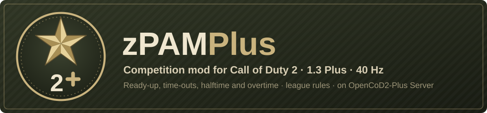

# zPAM Plus

<p align="center"></p>


[](https://github.com/eyza-cod2/zpam3)
[](https://github.com/JotaJazz/zpam-plus/commits/master)

**Español** · [English](README.md)

**Reglas de liga para Call of Duty 2, en un servidor que las corre a 40 Hz.** zPAM Plus es el mod de competición de la familia OpenCoD2-Plus: las reglas y el flujo de partida de zPAM 3.38 (readyup, timeouts, descanso, overtime, grabación, vista de streamer), con los arreglos de zPAM 4.x que funcionan en este servidor, para nuestros servidores, servidores públicos y, más adelante, un ladder automático.

Es un fork de [eyza-cod2/zpam3](https://github.com/eyza-cod2/zpam3), el mod con el que juega la mayoría de las ligas de CoD2. Solo corre en [OpenCoD2-Plus Server](https://github.com/JotaJazz/OpenCoD2-Plus-Server) compilado para CoD2 1.3 Plus, que solo admite el cliente [OpenCoD2-Plus](https://github.com/JotaJazz/OpenCoD2-Plus), todavía en desarrollo.

## Qué hace hoy

- **Flujo de partida:** readyup, cuenta atrás de inicio, timeouts, descanso con cambio de lado, overtime o empate (sub-modo `draw`), rondas de pistola (bash), un marcador que se puede restaurar tras un crash y grabación automática de demos.
- **Modos de liga:** `pub`, `comp` y `warmup` de dm, con `mr3` a `mr15`, `20rounds` o límites de tiempo, y las opciones `2v2`, `rifle`, `draw`, `lan` y `custom`, para sd, re, tdm, dm, ctf, htf y hq, además de strat para ensayar tácticas con bots grabados.
- **40 Hz:** comp, strat y el warmup de dm corren a `sv_fps 40` con un snapshot por frame; todos los temporizadores duran segundos reales con cualquier tick rate.
- **Duelos justos:** las reglas del motor para la recarga rápida, el prone peek y el MG clip, aplicadas en el servidor y en la predicción del cliente; un patrón fijo de perdigones para la escopeta con rangos consistentes; daño fijo de la MG; disparos al cuello que cuentan como a la cabeza; arreglos de hitbox de mano y torso.
- **Para jugadores y casters:** indicadores de impacto y de kill, jugadores restantes, marcador de equipos, información de la partida, un equipo streamer con su propio HUD, auto-espectador y repeticiones de kills, y estadísticas por jugador que se mantienen al reconectar.
- **Para admins:** menús rcon para mapas, modos, kicks y ajustes, avisos de ajustes erróneos, nombres que no pueden romper el log ni esconderse tras atajos de teclado, y una comprobación que rechaza cualquier servidor que no sea el build Plus.

Cada cambio respecto a zPAM 3.38 está en [docs/CHANGES.md](docs/CHANGES.md) (en inglés); el manual de zPAM 3.38, con cada ajuste y mensaje, se conserva en [docs/upstream/zpam-3.38.md](docs/upstream/zpam-3.38.md).

> [!NOTE]
> **Todavía en pruebas.** Se jugó una partida en el servidor Plus; la mayoría de las reglas nuevas aún necesitan una sesión con jugadores reales. Si algo se comporta distinto que en zPAM, repórtalo en los [issues](https://github.com/JotaJazz/zpam-plus/issues).

> [!IMPORTANT]
> **Solo servidor Plus.** En un servidor 1.0 o 1.3 original, CoD2x o cualquier otro build, el mod muestra "zPAM is not installed correctly" y no empieza ninguna partida. Esos servidores siguen usando [zPAM 3.38](https://github.com/eyza-cod2/zpam3).

## Instalación

| Necesita | |
|---|---|
| Servidor | OpenCoD2-Plus Server compilado con `make PLUS=1` (versión Plus 123 o posterior) |
| Jugadores | el cliente OpenCoD2-Plus ("1.3 Plus") |

Pon en la carpeta `main` del servidor:

- `zpamplus1.iwd` (el nombre no puede cambiar), generado con `tools/build-iwd.sh`
- `zpam_maps_v6.iwd`, los mapas arreglados

Después pon `fs_game ""` (el mod corre desde `main`), `sv_wwwDownload 1` y `sv_wwwBaseURL` apuntando a una carpeta que sirva los dos archivos, y elige un modo:

```
rcon pam_mode comp_mr12       // sd de liga, 12 rondas por mitad
rcon pam_mode comp_mr12_draw  // igual, pero un empate se queda en empate
rcon pam_mode pub             // servidor público
```

## Para colaboradores

Toda ayuda cuenta: jugar una partida de prueba, montar un servidor o escribir código. Los scripts son GSC en `source/`; la documentación técnica, en inglés, empieza en [docs/README.md](docs/README.md), y [AGENTS.md](AGENTS.md) es el punto de entrada para agentes de IA. Genera el iwd con `tools/build-iwd.sh` y pruébalo con `tools/run-server.sh` contra una carpeta de CoD2 que solo tenga los iwd originales.

## Transparencia

- **Quién lo mantiene:** soy JotaJazz. Me gustan los juegos antiguos y quiero que las ligas de CoD2 sigan teniendo un servidor y un mod donde jugar.
- **Cómo se trabaja:** trabajo con [Claude Code](https://claude.com/claude-code), el asistente de programación de Anthropic. Los cambios de este fork, incluidos este README y su traducción, se escriben con su ayuda. Los commits hechos así llevan una línea `Co-Authored-By: Claude` en su mensaje, así que se pueden identificar en el historial con `git log`.
- **Relación con el original:** este fork revisa cada commit nuevo de zPAM y toma, a mano, los que funcionan en el servidor Plus; no envía los suyos de vuelta. zPAM 4.x está revisado hasta la 4.11.
- **Qué no es:** no es un proyecto oficial y no está afiliado a Activision, Infinity Ward ni a los autores de zPAM. No contiene archivos del juego.

## Aviso

zPAM Plus es un mod independiente. No está afiliado a Activision Publishing, Inc., Infinity Ward ni a ninguna de sus filiales, ni autorizado, patrocinado o respaldado por ellas.

"Call of Duty" y "Call of Duty 2" son marcas registradas de Activision Publishing, Inc. En este repositorio se usan solo para identificación e interoperabilidad. No se reclama ningún derecho sobre esas marcas.

Este proyecto no proporciona ni ayuda a obtener datos del juego protegidos por derechos de autor. Para jugar necesitas una copia de Call of Duty 2 que sea legalmente tuya.

Si eres titular de derechos y crees que algo de aquí no debería distribuirse, abre un issue o contacta al mantenedor y se atenderá cuanto antes.

## Licencia

Ninguna todavía: [eyza-cod2/zpam3](https://github.com/eyza-cod2/zpam3), el proyecto del que esto es un fork, no publica una licencia, así que este fork no añade una por su cuenta.

## Créditos

- eyza y Fjozek, autores de zPAM
- Los colaboradores de [eyza-cod2/zpam3](https://github.com/eyza-cod2/zpam3), cuyos arreglos e ideas conserva este fork
- Activision / Infinity Ward
