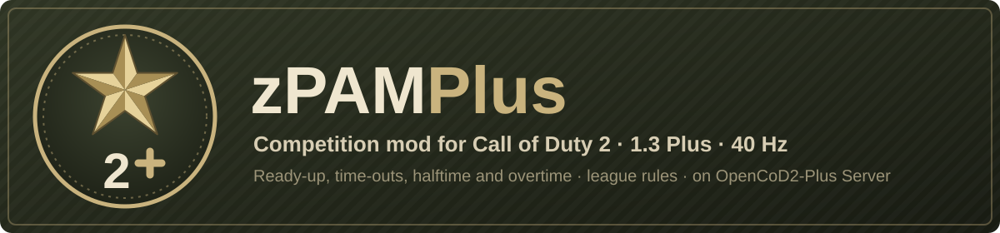

# zPAM Plus

<p align="center"></p>


[](https://github.com/eyza-cod2/zpam3)
[](https://github.com/JotaJazz/zpam-plus/commits/master)

[Español](README.es.md) · **English**

**League rules for Call of Duty 2, on a server that runs them at 40 Hz.** zPAM Plus is the competition mod of the OpenCoD2-Plus family: the zPAM 3.38 rules and match flow (ready-up, time-outs, halftime, overtime, recording, a streamer view), with the zPAM 4.x fixes that work on this server, for our servers, public servers and, later, an automatic ladder.

It is a fork of [eyza-cod2/zpam3](https://github.com/eyza-cod2/zpam3), the mod most CoD2 leagues play on. It runs only on [OpenCoD2-Plus Server](https://github.com/JotaJazz/OpenCoD2-Plus-Server) built for CoD2 1.3 Plus, which takes only the [OpenCoD2-Plus](https://github.com/JotaJazz/OpenCoD2-Plus) client, still in development.

## What it does today

- **Match flow:** ready-up, start countdown, time-outs, halftime with side swap, overtime or a draw (`draw` sub-mode), pistol bash rounds, a score that can be set after a crash, and auto-recording of demos.
- **League modes:** `pub`, `comp` and dm `warmup`, with `mr3` to `mr15`, `20rounds` or time limits, and the `2v2`, `rifle`, `draw`, `lan` and `custom` options, for sd, re, tdm, dm, ctf, htf and hq, plus strat for practising tactics with recorded bots.
- **40 Hz:** comp, strat and dm warmup run `sv_fps 40` with a snapshot every frame; every timer lasts real seconds at any tick rate.
- **Fair fights:** the engine's rules for fast reload, prone peek and the MG clip, applied on the server and in the client's prediction; a fixed shotgun pellet pattern with consistent ranges; fixed MG damage; neck shots that count as head shots; hand and torso hitbox fixes.
- **For players and casters:** hit and kill indicators, players left, team scores, match info, a streamer team with its own HUD, auto-spectator and kill replays, and per-player stats kept through a reconnect.
- **For admins:** rcon menus for maps, modes, kicks and settings, warnings for wrong settings, names that cannot break the log or hide behind key bindings, and a check that refuses any server that is not the Plus build.

Every change from zPAM 3.38 is in [docs/CHANGES.md](docs/CHANGES.md); the zPAM 3.38 manual, with every setting and message, is kept in [docs/upstream/zpam-3.38.md](docs/upstream/zpam-3.38.md).

> [!NOTE]
> **Still being tested.** One match has been played on the Plus server; most of the newer rules still need a session with real players. If something behaves differently from zPAM, please report it in the [issues](https://github.com/JotaJazz/zpam-plus/issues).

> [!IMPORTANT]
> **Plus server only.** On a stock 1.0 or 1.3 server, CoD2x, or any other build, the mod shows "zPAM is not installed correctly" and does not start a match. Those servers keep using [zPAM 3.38](https://github.com/eyza-cod2/zpam3).

## Install

| Needs | |
|---|---|
| Server | OpenCoD2-Plus Server built with `make PLUS=1` (Plus version 123 or later) |
| Players | the OpenCoD2-Plus client ("1.3 Plus") |

Put in the server's `main` folder:

- `zpamplus1.iwd` (the name must not change), built with `tools/build-iwd.sh`
- `zpam_maps_v6.iwd`, the fixed maps

Then set `fs_game ""` (the mod runs from `main`), `sv_wwwDownload 1` and `sv_wwwBaseURL` to a folder that serves both files, and pick a mode:

```
rcon pam_mode comp_mr12       // league sd, 12 rounds a half
rcon pam_mode comp_mr12_draw  // the same, a tie stays a tie
rcon pam_mode pub             // public server
```

## For contributors

Help of every kind counts: playing a test match, running a server, or code. The scripts are GSC under `source/`; the technical documentation, in English, starts at [docs/README.md](docs/README.md), and [AGENTS.md](AGENTS.md) is the entry point for AI coding agents. Build the iwd with `tools/build-iwd.sh` and test it with `tools/run-server.sh` against a CoD2 folder with only the stock iwds.

## Transparency

- **Who maintains this:** I'm JotaJazz. I like old games, and I want CoD2 leagues to keep having a server and a mod to play on.
- **How the work is done:** I work with [Claude Code](https://claude.com/claude-code), Anthropic's coding assistant. The changes in this fork, including this README and its translation, are written with its help. Commits made this way carry a `Co-Authored-By: Claude` line in their message, so they can be identified in the history with `git log`.
- **Relationship with the original:** this fork reviews every new zPAM commit and takes, by hand, the ones that work on the Plus server; it does not send its own back. zPAM 4.x was reviewed up to 4.11.
- **What it is not:** it is not an official project and is not affiliated with Activision, Infinity Ward or the authors of zPAM. It contains no game files.

## Notice

zPAM Plus is an independent mod. It is not affiliated with, authorized by, sponsored by, or endorsed by Activision Publishing, Inc., Infinity Ward, or any of their affiliates.

"Call of Duty" and "Call of Duty 2" are trademarks of Activision Publishing, Inc. They are used in this repository only for identification and interoperability. No claim is made to those marks.

This project does not provide or help obtain copyrighted game data. To play, you need a copy of Call of Duty 2 that you legally own.

If you are a rights holder and believe something here should not be distributed, please open an issue or contact the maintainer and it will be addressed promptly.

## License

None yet: [eyza-cod2/zpam3](https://github.com/eyza-cod2/zpam3), the project this is a fork of, publishes no license, so this fork does not add one on its own.

## Credits

- eyza and Fjozek, authors of zPAM
- The contributors to [eyza-cod2/zpam3](https://github.com/eyza-cod2/zpam3), whose fixes and ideas this fork keeps
- Activision / Infinity Ward
